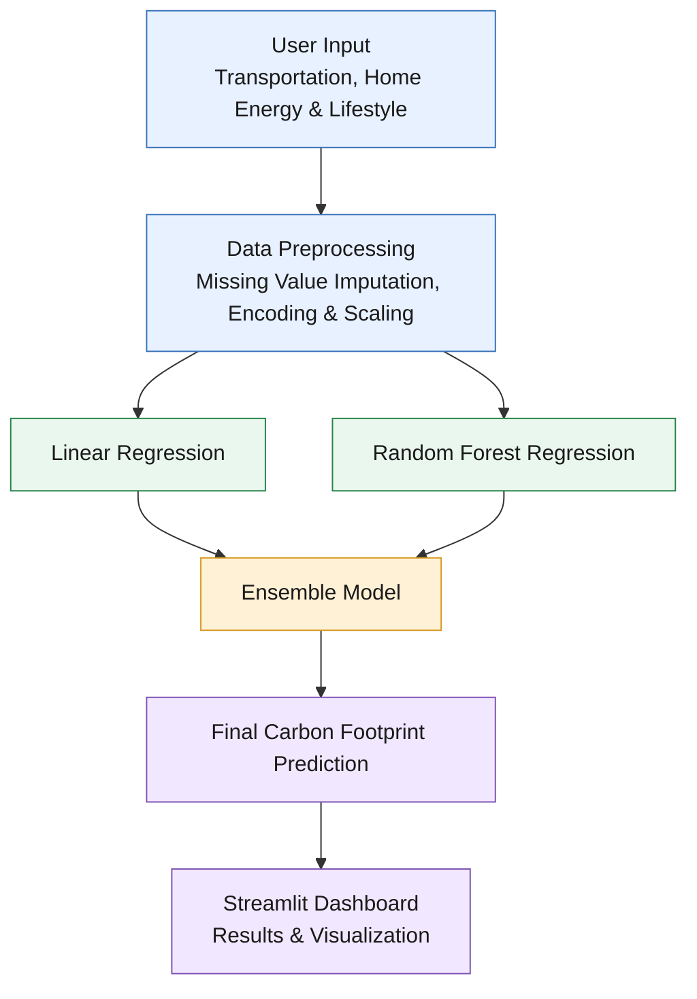

# Carbon Footprint Calculator using Machine Learning

A Streamlit-based application that estimates an individual's annual carbon footprint using transportation, household energy-consumption, and lifestyle inputs. It presents an overall estimate alongside category-wise emissions to make the results easier to understand.

## 🚀 Live Demo

**Try the application here:** 
[Carbon Footprint Calculator – Live App](https://carbon-footprint-calculator-mato.streamlit.app/)

> **Source code:** The implementation repository is kept private. The public showcase contains project documentation, demo and presentation materials only. Source code can be discussed or shared privately upon request.

## Project overview

The project explores how machine learning can be used to estimate an individual's carbon footprint from lifestyle and behavioural information. Users provide information about transportation, home energy use, and lifestyle habits. The application produces an estimated annual footprint and a breakdown across the three categories.

The interface is built with Streamlit and presents the output through visual summaries, including gauge and pie-chart visualizations. It also provides feature-importance insights and practical suggestions intended to help users consider lower-carbon choices.

## Highlights

- Estimates an individual's annual carbon footprint.
- Separates estimated emissions into transportation, home energy, and lifestyle categories.
- Combines Linear Regression and Random Forest predictions through an ensemble approach.
- Uses category-specific Random Forest regressors for a more detailed emissions breakdown.
- Presents results through interactive visualizations.
- Includes feature-importance insights and reduction suggestions.

## Machine learning workflow

### Dataset

The project report describes a dataset containing **673 samples and 10 features**. The features cover transportation habits, household energy use, and lifestyle factors. Examples include weekly distance driven, monthly electricity usage, electronic-gadget usage, and diet type.

### Preprocessing

The reported preprocessing workflow includes:

1. Imputing missing values using the median.
2. Encoding categorical variables.
3. Applying `StandardScaler` for feature scaling.
4. Splitting the data into training and testing sets using a **70:30 ratio**.

### Models

| Model | Role in the project |
|---|---|
| Linear Regression | Provides an interpretable baseline for modelling linear relationships. |
| Random Forest Regressor | Models non-linear relationships and interactions between input features. |
| Ensemble | Averages the Linear Regression and Random Forest predictions. |

In addition to the overall footprint prediction, category-specific Random Forest regressors are used for:

- Transportation CO₂
- Home Energy CO₂
- Lifestyle CO₂

### Evaluation

The project report identifies two regression evaluation metrics:

- **RMSE (Root Mean Squared Error):** measures the magnitude of prediction errors.
- **R² score:** indicates the proportion of target variance explained by the model.

The report describes the ensemble as an approach intended to combine the strengths of the two regressors. Exact numerical evaluation results are not included in this showcase; no performance figures are claimed here.

## Application workflow



## Technology stack

- **Language:** Python
- **Application interface:** Streamlit
- **Machine learning:** Scikit-learn
- **Data handling:** Pandas, NumPy
- **Visualization:** Gauge and pie-chart visualizations in the application

## Screenshots

Add selected screenshots of the application to the `screenshots/` folder, then embed them here. Use screenshots that do not expose private data, credentials, local file paths, or information you do not want publicly visible.

Example Markdown (replace the filenames with the screenshots you add):

```md


```

## Project materials

This public repository is intended to contain presentation materials only:

```text
carbon-footprint-calculator-showcase/
├── README.md
├── architecture.mmd
└── screenshots/
    └── .gitkeep
```

The original implementation, model files, notebooks, and any private datasets remain in the separate private repository.

## Scope and limitations

This project demonstrates a machine-learning workflow for estimating personal carbon emissions from a defined set of input features. The estimates depend on the dataset and assumptions used in the project. They should be treated as estimates for awareness and exploration, not as audited emissions inventories or professional environmental assessments.

## Future directions

Potential extensions identified in the project report include educational modules, corporate sustainability use cases, region-specific emission factors, multilingual support, and carbon-offset recommendations.

## References

1. C. Chatterjee, R. Gupta, K. Gupta and N. Hasteer, “Platforms To Calculate Carbon Footprints: A Step Towards Environment Sustainability,” 2023 International Conference on Advancement in Computation & Computer Technologies (InCACCT), 2023. [https://doi.org/10.1109/InCACCT57535.2023.10141821](https://doi.org/10.1109/InCACCT57535.2023.10141821)
2. J. R. Jessy Michla et al., “Carbon Footprint Calculator with Sustainability Suggestions,” 2024 15th International Conference on Computing Communication and Networking Technologies (ICCCNT), 2024. [https://doi.org/10.1109/ICCCNT61001.2024.10724579](https://doi.org/10.1109/ICCCNT61001.2024.10724579)
3. J. Mulrow, K. Machaj, J. Deanes and S. Derrible, “The state of carbon footprint calculators: An evaluation of calculator design and user interaction features,” *Sustainable Production and Consumption*, 2018. [https://doi.org/10.1016/j.spc.2018.12.001](https://doi.org/10.1016/j.spc.2018.12.001)
4. M. Büchs et al., “Promoting low carbon behaviours through personalised information? Long-term evaluation of a carbon calculator interview,” *Energy Policy*, 2018. [https://doi.org/10.1016/j.enpol.2018.05.030](https://doi.org/10.1016/j.enpol.2018.05.030)

---

**Interested in the implementation?** The source-code repository is private; please contact me to discuss access.
